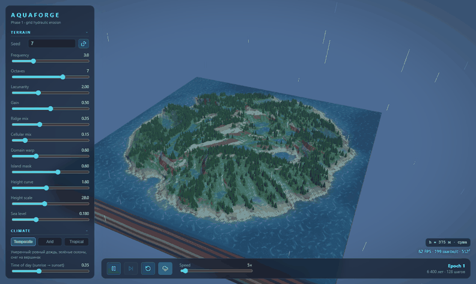
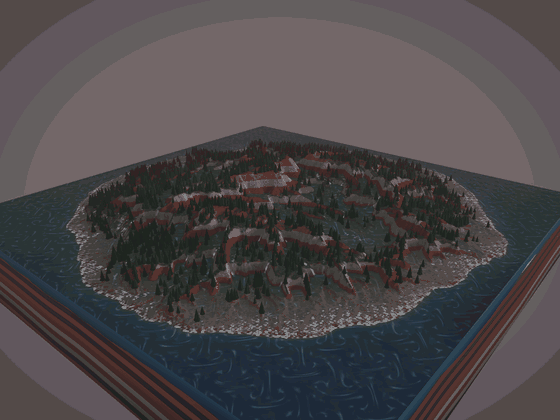
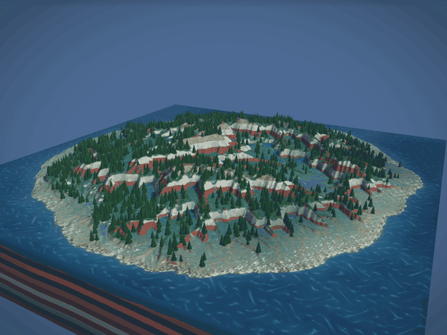
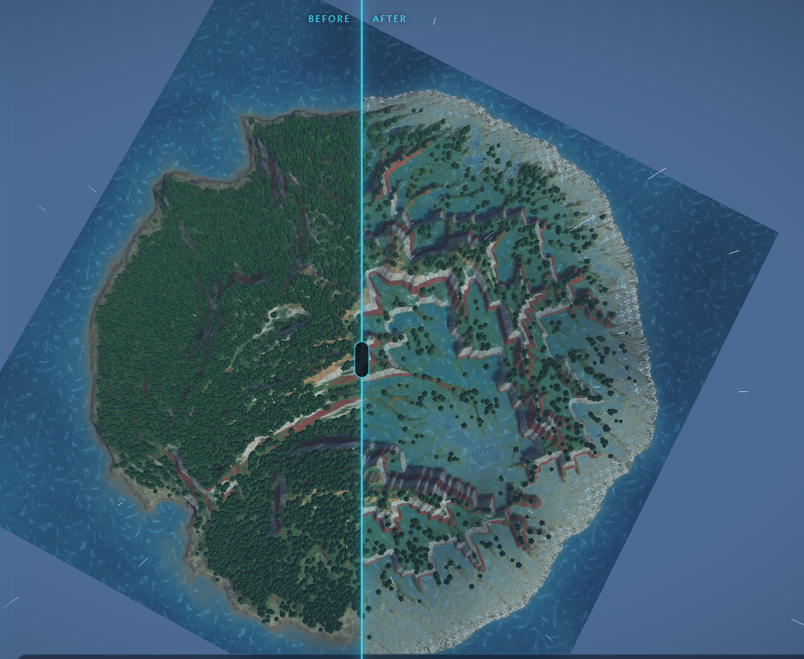
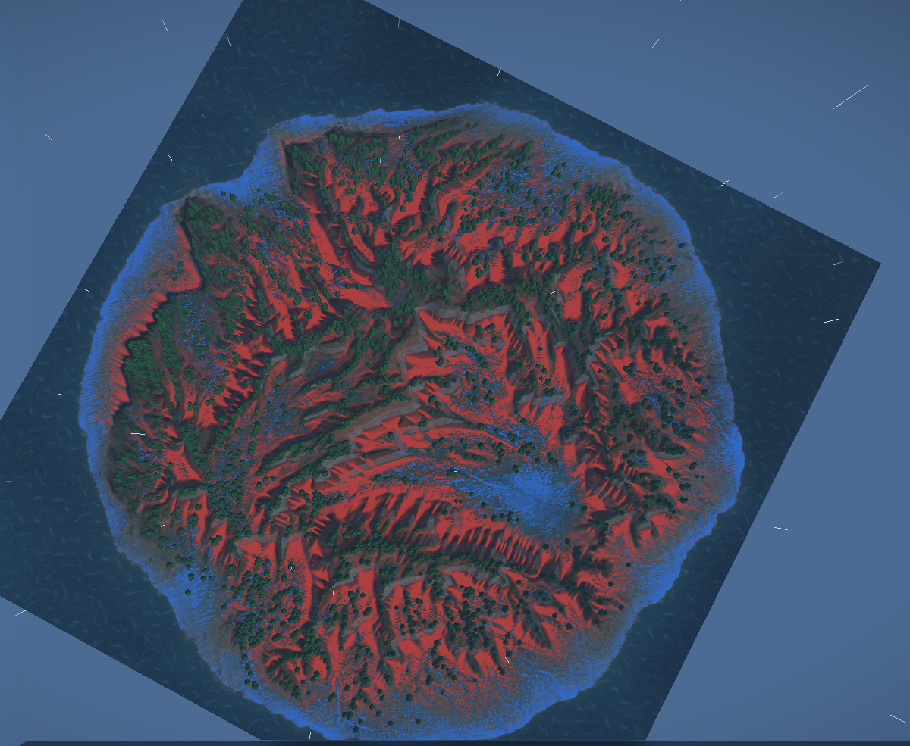
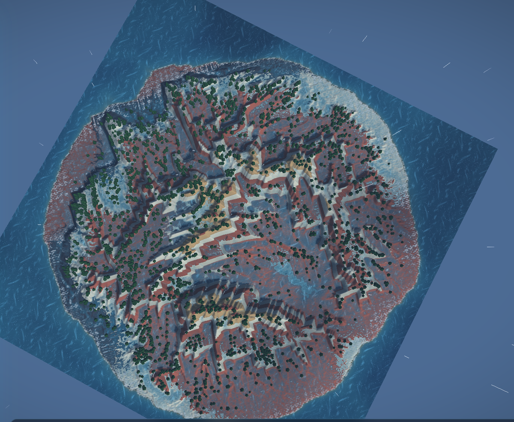
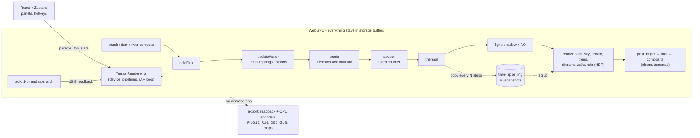

# AQUAFORGE

**A hydraulic-erosion terrain sandbox that runs entirely on the GPU, in the browser. Rain carves a procedurally generated island; you can dig rivers, build dams, scrub through time, cut the island open and record a fly-through.**

Written in raw WebGPU + WGSL (no Three.js or any 3D framework), React + TypeScript for the UI.

> **Requires a browser with WebGPU** (Chrome or Edge, desktop). There is no WebGL fallback - see [Browser support](#browser-support--requirements).

<p align="center"></p>

<p align="center"><sub>512x512 heightfield, rain eroding a fresh island under a slow camera orbit.</sub></p>

### What is interesting here

- **Simulation fully on the GPU.** A grid shallow-water model (virtual pipes, after Mei et al. 2007) with sediment erosion/deposition, semi-Lagrangian sediment advection and thermal erosion: five compute passes per step, nothing read back to the CPU while it runs.
- **Measured, documented optimisation: 900 → ~2,560 steps/s (x2.8)** on a 512² grid by tiling into workgroup memory (16x16 + halo), fusing passes (7 → 5) and storing flux/sediment as f16 (automatic f32 fallback). The profile ends memory-bandwidth-bound. Numbers and the hardware they were taken on: [Performance](#performance).
- **No CPU copies of the terrain for interaction.** Mouse picking is a one-thread GPU raymarch that reads back 16 bytes; time-lapse snapshots are GPU→GPU copies into a 96-frame ring (96 MB), so scrubbing history costs the CPU nothing.
- **Geology without extra buffers.** Rock type is an analytic function of (position, height) - four tilted, bent strata - shared between the erosion shader (soft rock dissolves faster) and the renderer (diorama walls, cross-section, Geology view).
- **Hand-written renderer:** HDR scene + bloom, soft sun shadows and ambient occlusion from a compute pass, procedural instanced forest, clouds with cloud shadows, rain, foam, caustics.

<p align="center">
  
  
</p>
<p align="center"><sub>Left: time of day (compute-shader shadows + AO, warm sunset sky). Right: diorama and the movable cross-section plane through the strata.</sub></p>

| Before / After split view | Erosion heat overlay | Rock strata (Geology view) |
|---|---|---|
|  |  |  |

## Try it in one minute

```bash
npm install
npm run dev        # http://localhost:5183 (open in Chrome or Edge)
```

1. Press **Space** (or the play button). Rain starts eroding the island; valleys appear within seconds.
2. Press **2** (Rain) or **3** (Raise) and drag on the terrain; **5** places a river source; **6** drags out a dam.
3. Open **Climate** in the panel for *Time of day*, forest density, fog, bloom; try the Arid / Monsoon presets.
4. Turn on **Before/After** or **Overlay → Erosion** to see what the water did; use the time-lapse scrubber in the bottom bar.
5. **Geology & view**: enable Diorama and drag the cross-section slider.

Hotkeys: `Space` play/pause, `R` regenerate, `1`-`6` tools (Orbit, Rain, Raise, Lower, River, Dam), `[` `]` brush radius, `H` hide panel; double-click focuses the camera on a point. Panel sections collapse on click.

`npm run build` produces a static `dist/` (relative base path, so it can be hosted from any static server).

## Features

- **GPU erosion.** Virtual-pipe shallow water, capacity-based erosion/deposition (rock hardness scales dissolution), sediment advection, thermal erosion with a talus angle. 512² grid.
- **Geology.** Clay, sandstone, limestone, basalt as analytic tilted strata. Biome and Geology views, a 4-sided **diorama** and a movable **cross-section**.
- **God tools.** Rain, raise/lower, **dam** (a line whose breach emerges from the erosion itself) and up to 8 **river sources**; all work on a paused simulation.
- **Overlays.** Erosion heat (wash-out vs. deposition), velocity strokes, height difference from the original terrain.
- **Time-lapse and Before/After.** 96-frame GPU ring buffer with a scrubber; draggable split view of the original and eroded terrain with a shared camera.
- **Atmosphere.** Time of day (sun height/azimuth, warm sunset sky), compute-shader soft shadows + AO, instanced procedural trees (only on dry, gentle, low land; they vanish where a channel is cut), drifting clouds that cast shadows, rain streaks and ripples, wet sand, snow glints, turbid fast water, foam, shallow-water caustics.
- **Cinematic camera.** Keyframed Catmull-Rom flight (or auto-orbit), recorded to **WebM** frame by frame, optionally with the simulation running during the shot.
- **Climate presets and Story mode.** Temperate / Arid canyon / Tropical monsoon (palette, fog, sim parameters, storms) and an auto-generated "geological chronicle" derived from simulation statistics (rivers merge, valley incision depth, volume eroded, lakes, deltas), exportable as Markdown. The chronicle's scale is stylised (island ≈ 25 km, peak ≈ 1100 m).
- **Export.** 16-bit height PNG, RAW `.r16`, `.obj` and `.glb` meshes, splatmap, flowmap, 16-bit erosion map and a scale `.json` for game-engine landscape import.

## Architecture



| Path | What |
|---|---|
| `src/gpu/simShader.ts` | Erosion compute passes (WGSL), `shader-f16` with f32 fallback via type aliases |
| `src/gpu/terrainShader.ts`, `strataShader.ts`, `lightShader.ts`, `postShader.ts` | Rendering: terrain/water/trees/sky/rain, strata, shadows+AO, bloom |
| `src/gpu/toolsShader.ts` | God-tool brushes and GPU picking |
| `src/gpu/TerrainRenderer.ts` | Device, pipelines, camera, frame loop, time-lapse, cinematic recording |
| `src/export/` | PNG16 (own encoder over `CompressionStream`), R16, OBJ/GLB, splat/flow/erosion maps |
| `src/story.ts`, `src/climate.ts` | Chronicle milestones, climate presets |
| `src/store.ts`, `src/App.tsx` | State and UI |

Notable design constraints: the sim's step counter and erosion accumulator share one `u32` buffer to stay within the default limit of 8 storage buffers per shader stage; the grid size must be a multiple of 16 (tile size).

## Performance

| | |
|---|---|
| Before optimisation (7 passes, no tiling) | ~900 steps/s |
| After (tiled, 5 passes, f16) | ~2,560 steps/s |
| Grid | 512 x 512, seed 7, one step ≈ 50 simulated years |
| Hardware | **One machine: an integrated AMD RDNA3 GPU in Chrome.** Memory bandwidth on it was estimated at ~60-70 GB/s, which is what the optimised sim is bound by. |

How it was measured: the simulation is driven in bulk through a dev-only hook (`window.__aqua.runSteps(n)`) and timed, because `requestAnimationFrame` is throttled when the page is not visible. This is a single-machine, single-seed measurement, not a benchmark suite; I have not measured NVIDIA, Apple or discrete AMD GPUs. The speed slider is adaptive (it requests steps per frame and backs off to hold ~45-60 FPS), so the achieved rate depends on the GPU. A "100x" setting at 60 FPS on 512² would need ~6,000 steps/s, which this hardware does not reach.

## Browser support / requirements

- **WebGPU is required.** Tested only in desktop Chrome/Edge on Windows with an integrated AMD GPU. Other browsers, other OSes and mobile are untested; there is **no WebGL fallback** - unsupported browsers get a "WebGPU unavailable" screen.
- `shader-f16` is optional: with it the sim stores flux/sediment as f16, without it everything runs in f32 (slower, same results modulo precision).
- Node.js + npm to build/run from source. No backend; everything is client-side.

## Known limitations

- **No automated tests.** Correctness was checked by hand: screenshots, numeric spot checks through dev hooks (e.g. height/water/accumulator readbacks, exported PNG16 decoded back and compared with the terrain, GLB structure parsed), and bisecting visual artefacts. File downloads and drag interactions (split divider, hotkeys, camera inertia, double-click focus) were verified through code/API paths rather than exhaustively by hand in a live browser.
- **Tuned on one seed.** Erosion defaults, climate presets and Story milestone thresholds were tuned on seed 7; other terrains may behave differently (milestones may fire earlier/later).
- **Heightfield limits.** No caves or overhangs; sediment is not a separate soil layer; rock type does not affect thermal erosion.
- **Water reflections show the sky only** (no screen-space or planar reflections of terrain); bloom strength was judged by eye; storm timing was tuned by eye.
- **Export.** The 512² size does not match engine-native landscape sizes (e.g. Unreal 505/1009/2017) - resample on import. Meshes carry no textures; use the splatmap.
- **Speed.** Speeds above what the GPU sustains are clamped (see Performance).
- **Time-lapse snapshots hide water** (only terrain is snapshotted).
- **Story mode** uses stylised scale and simple statistics; it narrates the simulation, it is not geomorphology.

## Roadmap

Ideas not implemented yet: a 256² "fast mode" and fusing erode+advect with halo recomputation for more steps/s; particle "drops" as a visual/point-erosion mode; planar water reflections; 1024²; challenge mode ("get the water to the town"); hosting a live demo (the build is static).

Design log with decisions and measurements: [`docs/TZ.md`](docs/TZ.md) (Russian), section 10.
